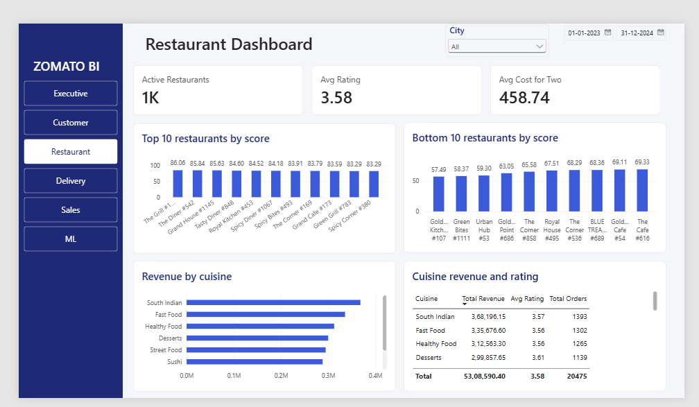
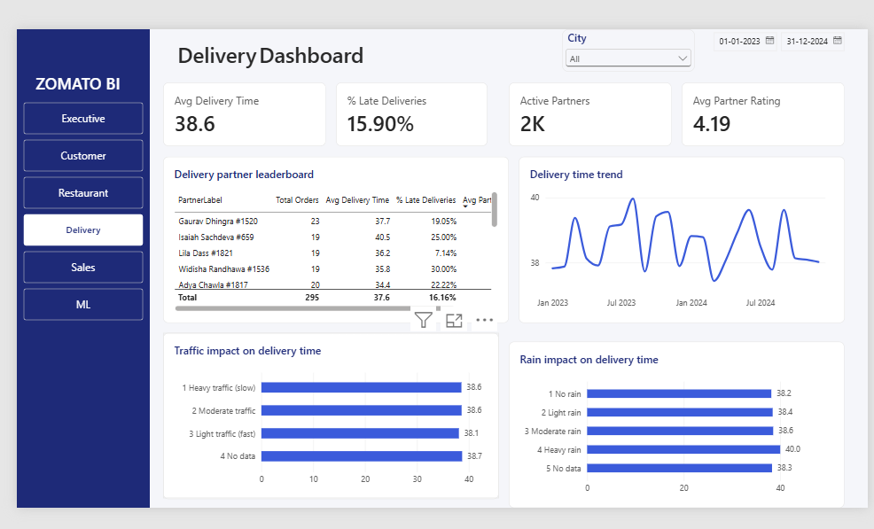
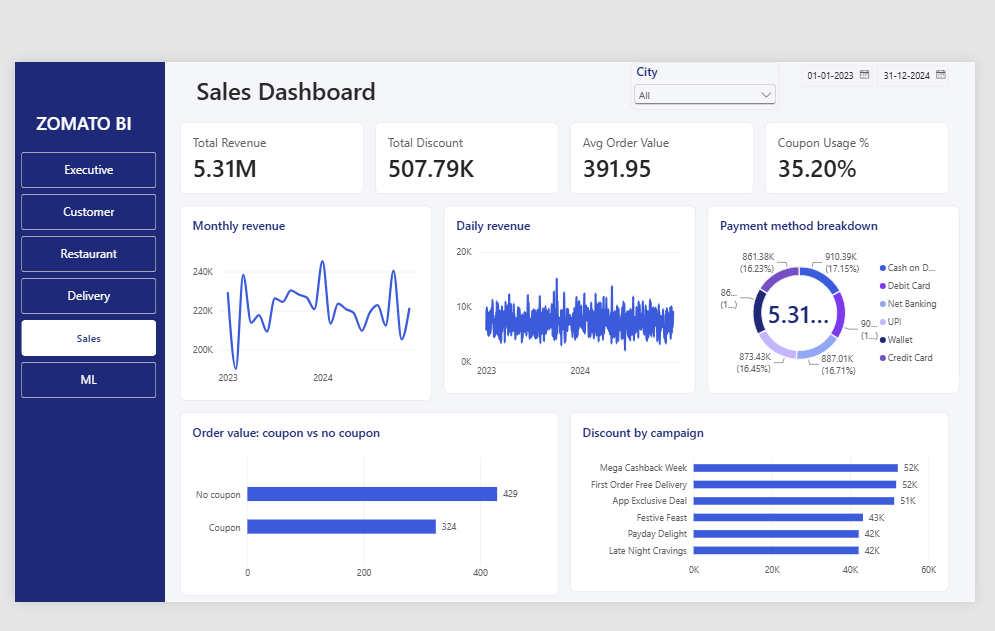
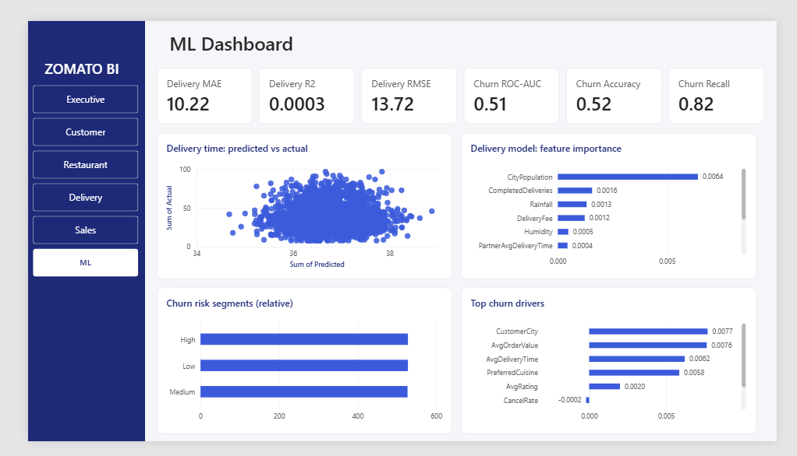

# Zomato Business Intelligence and Delivery Time Prediction Platform

An end-to-end data science project on a food delivery dataset: SQL analysis, data cleaning and EDA in Python, two machine learning models (delivery time prediction and customer churn) and a six-page Power BI dashboard.

**Data period:** January 2023 to December 2024  |  **Orders:** 20,475  |  **Tables:** 12

## Project Overview

The project acts as the analytics workstream of a food delivery company. It builds a clean data layer, answers business questions with SQL and Python, trains two prediction models and presents the results in an interactive dashboard and a written insights report.

**Business questions**

- How is the business performing overall (revenue, orders, delivery time, rating, late deliveries)?
- How do customers behave, and who is at risk of leaving?
- Which restaurants and cuisines perform best and worst?
- What drives delivery time, and how do traffic and rain affect it?
- How do coupons and discounts change sales?
- Can delivery time and customer churn be predicted from the available data?

**Key results**

| Metric | Value |
|---|---|
| Total orders | 20,475 |
| Delivered orders | 13,544 (11,390 on time, 2,154 late) |
| Total revenue (delivered orders) | 5.31 million |
| Average order value | 391.95 |
| Average delivery time | 38.57 minutes |
| Late deliveries | 15.90% of delivered orders |
| Average customer rating | 3.58 |
| Cancelled orders | 22.32% of all orders |
| Food not delivered | 11.54% of all orders |
| Orders using a coupon | 35.20% |

## Architecture

```
Raw CSV files (12 tables)
        |
        v
MySQL database: schema, integrity checks, business queries, views
        |
        v
Python (pandas) cleaning  ->  data/cleaned/  (12 cleaned CSV files)
        |
        +--> EDA and feature engineering (analytical base table, one row per order)
                 |
                 +--> Delivery time model (regression)   -> models/delivery_time_best_model.pkl
                 +--> Churn model (classification)       -> models/churn_best_model.pkl
                          |
                          v
                 powerbi/data/  (model output CSV files)
                          |
                          v
Power BI data model  ->  six-page dashboard  ->  business insights report and presentation
```

## Workflow

1. **Database and SQL.** Design the schema with primary and foreign keys, load the 12 tables, check integrity and write the business queries.
2. **Data cleaning.** Profile each table and fix missing values, duplicates, inconsistent text, mixed date formats and invalid values (`01_data_cleaning.ipynb`).
3. **EDA.** Explore revenue, cuisines, cities, delivery time, cancellations and customer behaviour (`02_eda.ipynb`).
4. **Feature engineering.** Build the analytical base table and derived features such as peak hour, weekend order, customer tenure and delivery efficiency (`03_feature_engineering.ipynb`).
5. **Modeling.** Compare several algorithms, tune the best ones and save the final models (`04_delivery_time_model.ipynb`, `05_churn_model.ipynb`).
6. **Dashboard and reporting.** Build the Power BI dashboard, write the business insights report and prepare the presentation.

## Dataset Description

Twelve connected tables, with orders at the centre of the schema.

| Table | What it holds | Key columns |
|---|---|---|
| orders | One row per order: amounts, status, delivery time | OrderID, CustomerID, RestaurantID, DeliveryPartnerID, OrderDate, DeliveryTimeMinutes, FinalAmount, OrderStatus, CouponCode |
| order_items | Items inside each order | OrderItemID, OrderID, FoodItemID, Quantity, TotalPrice |
| customers | Customer profile | CustomerID, City, Membership, RegistrationDate, PreferredCuisine |
| restaurants | Restaurant profile | RestaurantID, RestaurantName, Cuisine, City, Rating, AverageCost |
| menu | Food items per restaurant | FoodItemID, RestaurantID, Category, Price, PreparationTime |
| delivery_partners | Delivery partner profile | DeliveryPartnerID, VehicleType, City, Rating, CompletedDeliveries |
| customer_feedback | Ratings and reviews per order | OrderID, CustomerRating, DeliveryRating, FoodRating, Sentiment |
| payments | Payment records | PaymentID, OrderID, PaymentMethod, PaymentStatus |
| promotions | Coupon campaigns | CouponCode, CampaignName, DiscountPercentage, StartDate, EndDate |
| cities | City details | City, Population, Region, AverageIncome |
| weather | Daily weather per city | City, Date, Temperature, Rainfall, Humidity |
| traffic | Traffic readings per city | City, Date, Time, TrafficLevel, AverageSpeed |

The raw tables contained the usual problems of operational exports: missing values, duplicate rows, inconsistent city names and text spacing, mixed date formats, invalid values and outliers. The steps taken are in `notebooks/01_data_cleaning.ipynb`.

## Installation

```
python -m venv .venv
.venv\Scripts\activate
pip install -r requirements.txt
```

The project needs Python 3.10 or newer, MySQL for the SQL scripts, and Power BI Desktop for the dashboard.

## Usage

1. **Prepare the data.** Place the source files in `data/raw/`. The cleaned tables are written to `data/cleaned/` by `01_data_cleaning.ipynb`. The scripts in `sql/` create the database schema and run the business queries.
2. **Run the notebooks in order**, from `01_data_cleaning.ipynb` to `05_churn_model.ipynb`. The last two notebooks save the trained models in `models/` and write the model output files used by the dashboard to `powerbi/data/`.
3. **Open the dashboard.** Open `powerbi/zomato_dashboard.pbix` in Power BI Desktop. If Power BI asks for the data location, point it to `data/cleaned/` and `powerbi/data/`, and click **Refresh**.

## SQL Query Highlights

The scripts in `sql/` create the schema and answer the business questions with these constructs:

- **Core analysis:** joins, aggregations with `GROUP BY` and `HAVING`, and `CASE WHEN` for bucketing.
- **Advanced analysis:** CTEs, subqueries and window functions (`ROW_NUMBER`, `RANK`, `LAG`) for rankings and trends.
- **Reusable objects:** views for the order-level base table and the restaurant scorecard.

Examples of questions answered in SQL:

- Which restaurants earn the most revenue?
- What is the average delivery time by city?
- Which delivery partners rank highest by completed deliveries and rating?
- What share of orders is cancelled, by cuisine?
- Which coupons gave the largest discounts, and how many orders did they cover?

## EDA Highlights

Charts and tables are in `notebooks/02_eda.ipynb` and `reports/eda_report.pdf`.

- **Order outcomes.** 55.6% of orders are delivered on time, 10.5% late, 22.3% cancelled and 11.5% marked food not delivered.
- **Delivery time.** The average stays between about 37 and 41 minutes in every hour of the day, with no clear peak. Traffic shows no clear effect, and heavy rain adds about 1.8 minutes.
- **Revenue.** Monthly revenue stays between roughly 200K and 245K with no strong growth. South Indian, Fast Food and Healthy Food lead by revenue, and cuisine ratings sit between 3.56 and 3.61.
- **Payments.** The six payment methods each carry between 16.2% and 17.2% of revenue.
- **Discounts.** Coupon orders average about 324 against about 429 without a coupon, and discounts cost about 9.6% of revenue.
- **Customers.** 62.2% of customers placed two or more orders.

## Machine Learning Summary

| Model | Algorithm | Test set | Results |
|---|---|---|---|
| Delivery time (regression) | Linear Regression | 4,065 orders | MAE 10.22 min, RMSE 13.72 min, R2 0.0003 |
| Customer churn (classification) | Logistic Regression (C = 0.1) | 1,583 customers | Accuracy 0.525, Precision 0.539, Recall 0.821, F1 0.651, ROC-AUC 0.506 |

- **Models compared.** Delivery time: Linear Regression, Decision Tree, Random Forest and Gradient Boosting, plus tuned versions of the two ensembles and an average-value baseline. Churn: Logistic Regression, Decision Tree, Random Forest and Gradient Boosting, plus tuned versions and a baseline. The comparison tables are in `reports/delivery_model_comparison.csv` and `reports/churn_model_comparison.csv`.
- **Churn definition.** A customer counts as churned with no order in the last 270 days of the data (53.9% of customers).
- **Feature importance.** Calculated with permutation importance on the test set.
- **Reading the results.** The delivery model has the same MAE as always predicting the average, and the churn model has an AUC close to 0.5. Both results are below the project targets (R2 of 0.75 or more for delivery time, F1 of 0.70 or more for churn). The features in the dataset carry very little signal for either target, so the models should not be used for decisions yet.

## Power BI Dashboard Preview

The file `powerbi/zomato_dashboard.pbix` has six pages with a shared blue and purple theme, City and Date slicers where they apply, page navigation and tooltips.

| Page | What it shows |
|---|---|
| 1. Executive | Revenue, orders, delivery time, rating, active customers, late rate |
| 2. Customer | Retention rate, customer segments, growth over time, lifetime value distribution |
| 3. Restaurant | Top and bottom restaurants by composite score, cuisine revenue and rating |
| 4. Delivery | Partner leaderboard, delivery time trend, traffic and rain impact |
| 5. Sales | Revenue trend, coupon use and discount impact, payment methods |
| 6. ML | Predicted vs actual, feature importance, churn risk segments and drivers |

**Composite restaurant score (0 to 100):** 40% customer rating, 30% order volume (relative to the busiest restaurant) and 30% on-time delivery.

## Screenshots







## Project Structure

```
Zomato_Business_Intelligence_Project/
├── data/
│   ├── raw/                  original source files
│   └── cleaned/              12 cleaned tables used by the notebooks and Power BI
├── sql/
│   ├── schema.sql            database schema
│   └── business_queries.sql  business analysis queries
├── notebooks/
│   ├── 01_data_cleaning.ipynb
│   ├── 02_eda.ipynb
│   ├── 03_feature_engineering.ipynb
│   ├── 04_delivery_time_model.ipynb
│   └── 05_churn_model.ipynb
├── src/                      reusable Python scripts
├── models/
│   ├── delivery_time_best_model.pkl
│   └── churn_best_model.pkl
├── reports/
│   ├── eda_report.pdf
│   └── business_insights_report.pdf
├── powerbi/
│   ├── zomato_dashboard.pbix
│   └── data/                 model output files used by the ML page
├── images/                   dashboard screenshots used in this README
├── documentation/
│   └── prd.docx
├── README.md
├── LICENSE
└── requirements.txt
```

## Tools

Python (pandas, NumPy, scikit-learn, Matplotlib, Seaborn), MySQL, Jupyter Notebook, Power BI Desktop (DAX), Git and GitHub.

## Limitations

- Weather and traffic readings are missing for about 37% of orders, so the rain and traffic comparisons use the remaining orders.
- The composite restaurant score depends on the chosen weights.
- Customer risk segments on the ML page are relative rankings (top, middle and bottom third) and not true probabilities.
- Model results come from a single train and test split.

## Future Improvements

- Add stronger delivery features: distance between the restaurant and the customer, restaurant preparation time, order size and live partner location.
- Fill the weather and traffic gaps, and match them to the order time and city instead of the day.
- Add richer churn features, such as order frequency trends, complaint history and coupon response, and compare XGBoost.
- Turn the churn score into real probabilities and test retention offers with an A/B experiment.
- Deploy the delivery time model behind an API and refresh the dashboard automatically.

## License

This project is released under the MIT License. See the `LICENSE` file.

## Author

**Nidhi Ajmera**
nidhiajmera2012@gmail.com
