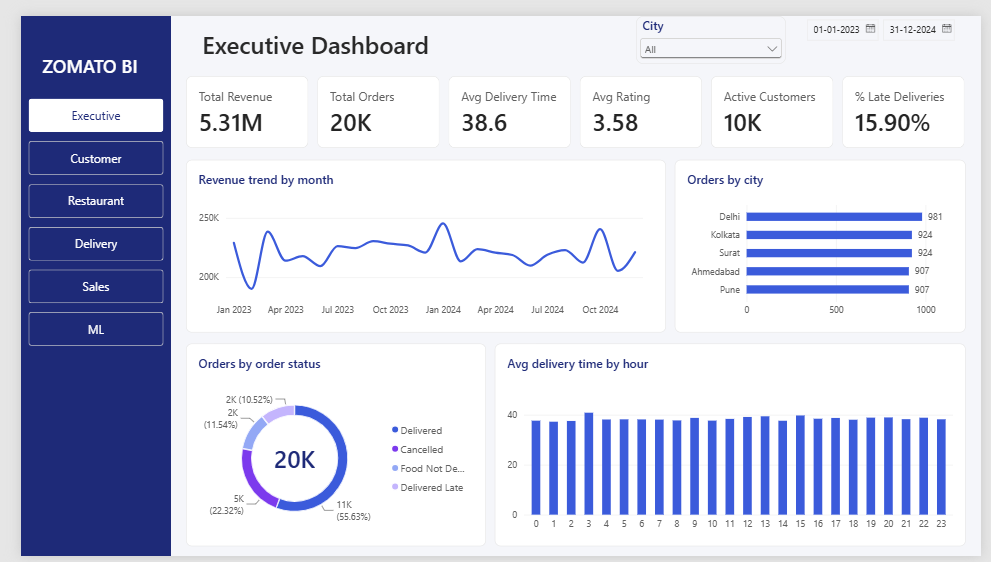
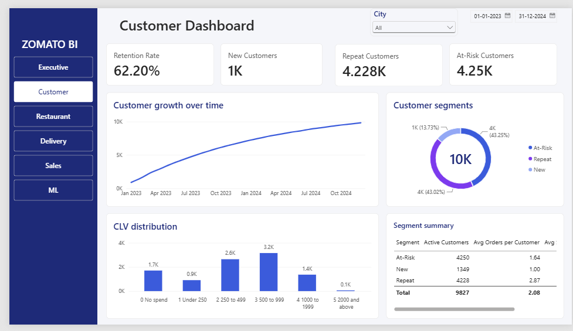

# Zomato Business Intelligence and Delivery Time Prediction Platform

An end-to-end data science project on a food delivery dataset: SQL analysis, data cleaning and EDA in Python, two machine learning models (delivery time prediction and customer churn) and a six-page Power BI dashboard.

**Data period:** January 2023 to December 2024  |  **Orders:** 20,475  |  **Tables:** 12

## Business questions

- How is the business performing overall (revenue, orders, delivery time, rating, late deliveries)?
- How do customers behave, and who is at risk of leaving?
- Which restaurants and cuisines perform best and worst?
- What drives delivery time, and how do traffic and rain affect it?
- How do coupons and discounts change sales?
- Can delivery time and customer churn be predicted from the available data?

## Key results

| Metric | Value |
|---|---|
| Total orders | 20,475 |
| Delivered orders | 13,544 (11,390 on time, 2,154 late) |
| Total revenue (delivered orders) | 5.31 million |
| Average order value | 391.95 |
| Average delivery time | 38.57 minutes |
| Late deliveries | 15.90% of delivered orders |
| Average customer rating | 3.58 |
| Cancelled orders | 22.32% of all orders |
| Food not delivered | 11.54% of all orders |
| Orders using a coupon | 35.20% |

**Main findings**

- 33.9% of all orders (cancelled plus food not delivered) never reach the customer, which is the largest source of lost revenue.
- Delivery time is almost the same across hours, traffic levels and weather. Only heavy rain shows a visible rise of about 1.8 minutes.
- Orders with a coupon are smaller than orders without one (about 324 against about 429), and discounts cost about 9.6% of revenue.
- Both machine learning models perform close to a simple baseline (see below), so they should not be used for decisions yet.

## Machine learning results

| Model | Algorithm | Test set | Results |
|---|---|---|---|
| Delivery time (regression) | Linear Regression | 4,065 orders | MAE 10.22 min, RMSE 13.72 min, R2 0.0003 |
| Customer churn (classification) | Logistic Regression (C = 0.1) | 1,583 customers | Accuracy 0.525, Precision 0.539, Recall 0.821, F1 0.651, ROC-AUC 0.506 |

- Churn is defined as no order in the last 270 days of the data (53.9% of customers).
- The delivery model has the same MAE as always predicting the average, and the churn model has an AUC close to 0.5. The features in the dataset carry very little signal for either target.
- Feature importance is calculated with permutation importance on the test set.

## Power BI dashboard

The file `powerbi/zomato_dashboard.pbix` has six pages with a shared blue and purple theme, City and Date slicers where they apply, page navigation and tooltips.

| Page | What it shows |
|---|---|
| 1. Executive | Revenue, orders, delivery time, rating, active customers, late rate |
| 2. Customer | Retention rate, customer segments, growth over time, lifetime value distribution |
| 3. Restaurant | Top and bottom restaurants by composite score, cuisine revenue and rating |
| 4. Delivery | Partner leaderboard, delivery time trend, traffic and rain impact |
| 5. Sales | Revenue trend, coupon use and discount impact, payment methods |
| 6. ML | Predicted vs actual, feature importance, churn risk segments and drivers |

**Composite restaurant score (0 to 100):** 40% customer rating, 30% order volume (relative to the busiest restaurant) and 30% on-time delivery.

### Screenshots





## Project structure

```
Zomato_Business_Intelligence_Project/
├── data/
│   ├── raw/                  original source files
│   └── cleaned/              12 cleaned tables used by the notebooks and Power BI
├── sql/
│   ├── schema.sql            database schema
│   └── business_queries.sql  business analysis queries
├── notebooks/
│   ├── 01_data_cleaning.ipynb
│   ├── 02_eda.ipynb
│   ├── 03_feature_engineering.ipynb
│   ├── 04_delivery_time_model.ipynb
│   └── 05_churn_model.ipynb
├── src/                      reusable Python scripts
├── models/
│   ├── delivery_time_best_model.pkl
│   └── churn_best_model.pkl
├── reports/
│   ├── eda_report.pdf
│   └── business_insights_report.pdf
├── powerbi/
│   ├── zomato_dashboard.pbix
│   └── data/                 model output files used by the ML page
├── images/                   dashboard screenshots used in this README
├── documentation/
│   └── prd.docx
├── README.md
└── requirements.txt
```

## Tools

Python (pandas, NumPy, scikit-learn, Matplotlib, Seaborn), MySQL, Jupyter Notebook, Power BI Desktop (DAX), Git and GitHub.

## How to run

1. **Create an environment and install the packages**
   ```
   python -m venv .venv
   .venv\Scripts\activate
   pip install -r requirements.txt
   ```
2. **Prepare the data.** Place the source files in `data/raw/`. The cleaned tables are written to `data/cleaned/` by `01_data_cleaning.ipynb`. The SQL scripts in `sql/` create the database schema and run the business queries.
3. **Run the notebooks in order**, from `01_data_cleaning.ipynb` to `05_churn_model.ipynb`. The last two notebooks save the trained models in `models/` and write the model output files used by the dashboard to `powerbi/data/`.
4. **Open the dashboard.** Open `powerbi/zomato_dashboard.pbix` in Power BI Desktop. If Power BI asks for the data location, point it to `data/cleaned/` and `powerbi/data/`, and click **Refresh**.

## Limitations

- Weather and traffic readings are missing for about 37% of orders, so the rain and traffic comparisons use the remaining orders.
- The composite restaurant score depends on the chosen weights.
- Customer risk segments on the ML page are relative rankings (top, middle and bottom third) and not true probabilities.
- Model results come from a single train and test split.

## Author

name :- Nidhi Ajmera

email:- nidhiajmera2012@gmail.com
